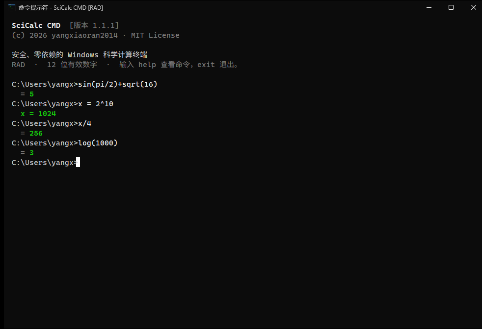
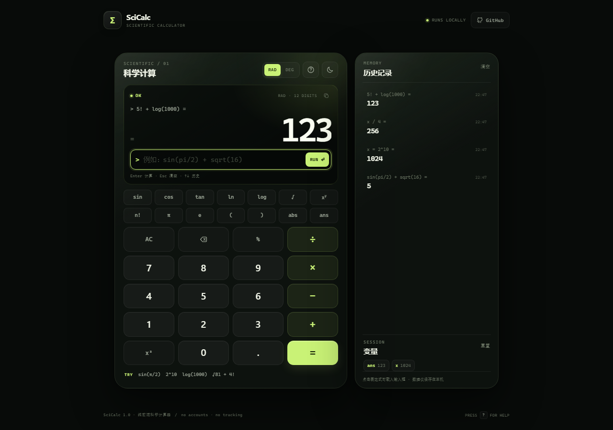
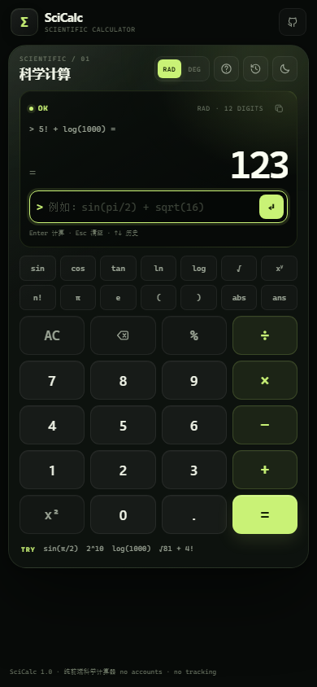

# SciCalc

一个同时提供 **Windows 桌面端**、**命令行** 和 **网页** 三种形态的科学计算器。零第三方运行时依赖，手写表达式解析器，不使用 `eval`。

<p align="center">
  
</p>

<p align="center">
  
</p>

<p align="center">
  
</p>

- **Desktop**：类似 Windows 命令提示符的桌面程序，支持输入历史、Tab 补全、F7 历史窗口、深色标题栏。
- **CLI**：交互式 REPL、单次执行、管道输入、变量、历史记录、角度制切换。
- **Web**：纯前端科学计算器，支持键盘输入、函数快捷键、历史、变量和浅色/深色主题。
- **共享能力**：三角函数、反三角函数、双曲函数、对数、指数、阶乘、隐式乘法、`ans` 与自定义变量。

在线体验：[https://yangxiaoran2014.github.io/scicalc/](https://yangxiaoran2014.github.io/scicalc/)

Windows 桌面版下载：[GitHub Releases](https://github.com/yangxiaoran2014/scicalc/releases/latest)

## 功能一览

| 能力 | Desktop | CLI | Web |
| --- | :---: | :---: | :---: |
| 四则运算、幂、整除、取模、阶乘 | ✅ | ✅ | ✅ |
| `sin/cos/tan`、反三角、双曲函数 | ✅ | ✅ | ✅ |
| `ln/log/log2/log10`、`sqrt/cbrt/exp` | ✅ | ✅ | ✅ |
| 角度制 / 弧度制 | ✅ | ✅ | ✅ |
| 隐式乘法 `2π`、`3(4+1)` | ✅ | ✅ | ✅ |
| 变量 `x = ...`、`ans` | ✅ | ✅ | ✅ |
| 计算历史 | ✅ | ✅ | ✅ 本地持久化 |
| 输入历史与快捷键 | ✅ 本地持久化 | ✅ 当前会话 | ✅ |
| 管道 / 脚本输入 | — | ✅ | — |
| 无网络、无账号、无追踪 | ✅ | ✅ | ✅ |

## Windows 桌面版

桌面版名为 **SciCalc CMD**，适用于 64 位 Windows 10 / 11，使用 Python 标准库 Tkinter 绘制，界面仿照 Windows 命令提示符。它和 CLI 共用同一个安全计算引擎。

### 直接运行 EXE

从 [Releases](https://github.com/yangxiaoran2014/scicalc/releases/latest) 下载 `SciCalcCMD-1.1.0-windows-x64.exe`，双击即可，不需要安装 Python。

> 这是一个未签名的个人构建。Windows SmartScreen 可能提示“未知发布者”，请核对 Release 中公布的 SHA-256 后运行。
>
> `SciCalcCMD-1.1.0-windows-x64.exe` SHA-256：`76BF1B8658E42BDEFCBBE38F7A54B1DD94242157373284B0CCB7229B3BA613F4`

### 从源码运行

需要 Python 3.10+（Windows 官方安装包自带 Tkinter）：

```powershell
git clone https://github.com/yangxiaoran2014/scicalc.git
cd scicalc

# 方式一：直接启动，不显示控制台窗口
pythonw scicalc-cmd.pyw

# 方式二：双击 run-scicalc-cmd.cmd

# 方式三：安装后使用命令
python -m pip install .
scicalc-desktop
```

### 使用方式

窗口本身就是计算器的输入区：

```console
C:\Users\me>sin(pi / 2) + sqrt(16)
  = 5
C:\Users\me>x = 2^10
  x = 1024
C:\Users\me>x / 4
  = 256
C:\Users\me>
```

内置命令（开头的 `:` 可省略）：

| 命令 | 说明 |
| --- | --- |
| `help`, `?` | 显示帮助 |
| `cls`, `clear` | 清屏 |
| `reset` | 清空变量和计算历史 |
| `vars`, `v` | 查看变量和 `ans` |
| `history [n]` | 查看最近 n 条计算记录 |
| `deg` / `rad` | 切换角度单位 |
| `precision N` | 设置有效数字（1–17） |
| `mode` | 查看角度、精度和历史状态 |
| `about` | 关于程序 |
| `exit`, `quit` | 退出 |

快捷键：

| 快捷键 | 功能 |
| --- | --- |
| `Enter` | 计算或执行命令 |
| `↑` / `↓` | 浏览输入历史 |
| `Tab` | 补全命令、函数和常量 |
| `F1` | 帮助（保留当前输入） |
| `F7` | 打开历史记录选择窗口 |
| `Ctrl+L` | 清屏 |
| `Ctrl+C` | 复制选中内容；没有选中时取消当前输入 |
| `Ctrl+V` / `Shift+Insert` | 粘贴 |
| `Esc` | 清空当前输入 |

角度单位、精度、输入历史和窗口位置保存在 `%APPDATA%\SciCalcCMD\state.json`。变量和计算结果不会跨进程保存。

### 自行打包 EXE

```powershell
python -m pip install ".[build]"
powershell -ExecutionPolicy Bypass -File .\build-windows.ps1
```

输出为 `dist\SciCalcCMD.exe`，脚本会同时打印文件大小和 SHA-256。PyInstaller 构建配置位于 [`packaging/`](packaging/)。

### 本地测试签名（可选）

如果要在本机验证 Authenticode 签名，可以运行：

```powershell
powershell -ExecutionPolicy Bypass -File .\sign-windows-test.ps1
```

脚本会创建一个仅用于本地测试的证书链，复制 `dist\SciCalcCMD-1.1.0-windows-x64.exe` 到 `dist\signed\`，使用 SHA-256 和 RFC 3161 时间戳签名，并导出 `SciCalc-LocalTest-RootCA.cer`。原始 EXE 不会被修改。

> 这是**自签名测试**，不是受信任的公开签名。其他电脑没有这个测试根证书，仍会显示“未知发布者”，SmartScreen 也可能继续拦截。不要把它当作公开发布签名。
>
> 若要让当前 Windows 用户在本机看到有效签名，可双击 `SciCalc-LocalTest-RootCA.cer`，选择“安装证书” → “当前用户” → “将所有的证书都放入下列存储” → “受信任的根证书颁发机构”。只在信任这台机器和这个测试证书时这样做。

脚本会输出删除测试根证书和签名证书的命令。公开发布若需要消除 SmartScreen 警告，必须使用受信任的 OV/EV 代码签名证书，或通过 SignPath / Azure Trusted Signing 等服务完成身份验证；自签名无法做到。

## 命令行使用

需要 Python 3.10 或更高版本。

```bash
git clone https://github.com/yangxiaoran2014/scicalc.git
cd scicalc
python -m scicalc
```

也可以安装为命令：

```bash
python -m pip install .
scicalc
```

### 单次执行

```console
$ python -m scicalc "sin(pi / 2) + sqrt(16)"
5

$ python -m scicalc --degrees "sin(30) + asin(0.5)"
30.5

$ python -m scicalc -p 5 "1 / 3"
0.33333
```

表达式包含空格时建议加引号。以负号开头的表达式也可以直接写：

```bash
python -m scicalc -2^2 + 10
# 6
```

### 交互模式

```console
$ python -m scicalc
SciCalc 1.1.0
科学计算器  ·  RAD  ·  12 位有效数字
输入 :help 查看命令，:quit 退出。

sci[rad]> sin(pi / 2)
  = 1
sci[rad]> x = 2^10
  x = 1024
sci[rad]> x / 4
  = 256
sci[rad]> :deg
角度单位已切换为 DEG。
sci[deg]> sin(30)
  = 0.5
```

内置命令：

| 命令 | 说明 |
| --- | --- |
| `:help`, `:h` | 显示帮助 |
| `:quit`, `:q` | 退出 |
| `:clear` | 清除变量和历史 |
| `:vars`, `:v` | 查看变量 |
| `:history [n]` | 查看最近记录 |
| `:deg`, `:rad` | 切换角度单位 |
| `:precision N` | 设置有效数字（1–17） |
| `:mode` | 查看当前模式 |

### 管道与脚本

```bash
printf '2^10\nsqrt(81)\nx = 5\nx * 2\n' | python -m scicalc
```

每行一条表达式或命令；`#` 后可作为注释。遇到错误时会继续处理剩余行，并以非零状态码退出。

## 表达式语法

```text
+  -  *  /  //  %  ^  !  ( )
sin cos tan sec csc cot
asin acos atan atan2  (arcsin / arccos / arctan 也可)
sinh cosh tanh asinh acosh atanh
ln log log2 log10 exp
sqrt cbrt abs sign floor ceil round trunc
factorial fact min max gcd lcm hypot pow mod
pi π  e  tau τ  phi  ans
```

- `log(x)` 为常用对数，`log(x, b)` 可指定底数。
- 幂运算从右向左结合：`2^3^2 = 512`。
- 支持隐式乘法：`2π`、`3(4+1)`、`2sqrt(9)`、`2√9`。
- 赋值语法：`x = 2^10`，之后可使用 `x` 和 `ans`。
- 桌面版和 CLI 的整数阶乘上限为 1000；网页版受 JavaScript 数值范围限制，上限为 170。
- 桌面版和 CLI 支持大整数，并自动显示为科学计数法。
- 复数不在支持范围内。

## 网页版

网页源码在 [`docs/`](docs/) 中，完全静态，可直接由 GitHub Pages 托管，也可以本地预览：

```bash
python -m http.server 8000 --directory docs
# 打开 http://localhost:8000
```

网页计算引擎位于 [`docs/core.js`](docs/core.js)，与 UI 解耦并有独立的 Node.js 测试。它同样是手写解析器，不使用 `eval`。

## 测试

Python（包括桌面命令层与 Tkinter 界面测试）：

```bash
python -m unittest discover -s tests -v
```

网页引擎（Node.js 22+）：

```bash
node --test tests/web/core.test.mjs
```

桌面 GUI 测试会在无法创建 Tk 窗口时自动跳过。

## 项目结构

```text
.
├── scicalc/                # 计算引擎、CLI 与 Windows 桌面端
│   ├── engine.py
│   ├── cli.py
│   ├── desktop.py          # Tkinter CMD 风格界面
│   └── desktop_session.py  # 无窗口命令层、状态持久化
├── docs/                   # GitHub Pages 静态站点与截图
│   ├── index.html
│   ├── styles.css
│   ├── app.js
│   └── core.js
├── tests/                  # Python 测试 + 网页核心测试
├── assets/                 # 桌面程序图标
├── packaging/              # PyInstaller 配置与版本信息
├── scicalc-cmd.pyw         # 无控制台启动器
├── run-scicalc-cmd.cmd     # Windows 双击启动脚本
├── build-windows.ps1       # EXE 构建脚本
├── sign-windows-test.ps1   # 本地自签名测试脚本
├── pyproject.toml
└── README.md
```

## 安全说明

表达式由专用词法分析器和递归下降解析器处理，只接受数字、运算符、固定函数和常量。没有使用 Python `eval` 或 JavaScript `eval`/`Function`，网页端不会上传输入内容，所有计算都在本地完成。

桌面版还会：

- 限制表达式长度、阶乘输入、指数大小和结果位数；
- 将控制台输入区与历史输出分隔，编辑键不会破坏提示符或旧输出；
- 以原子方式写入会话状态，并对读取的 JSON 做类型和范围校验；
- 限制剪贴板粘贴长度，避免异常大的输入拖慢界面。

## License

[MIT](LICENSE)

更新日志：[CHANGELOG.md](CHANGELOG.md)
